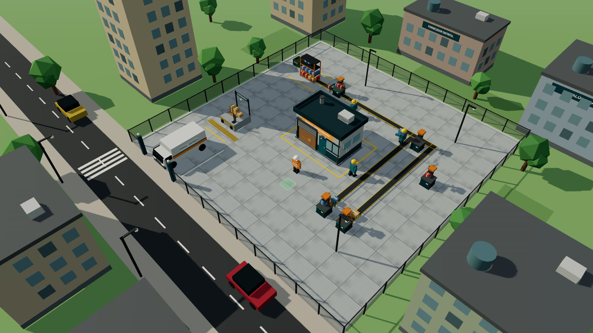
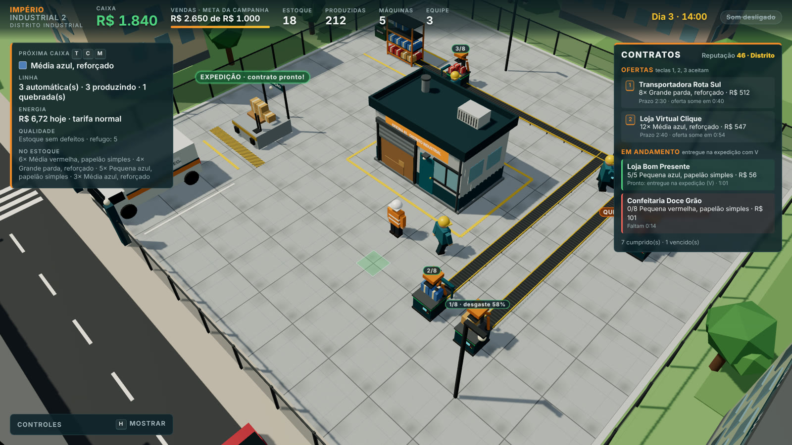
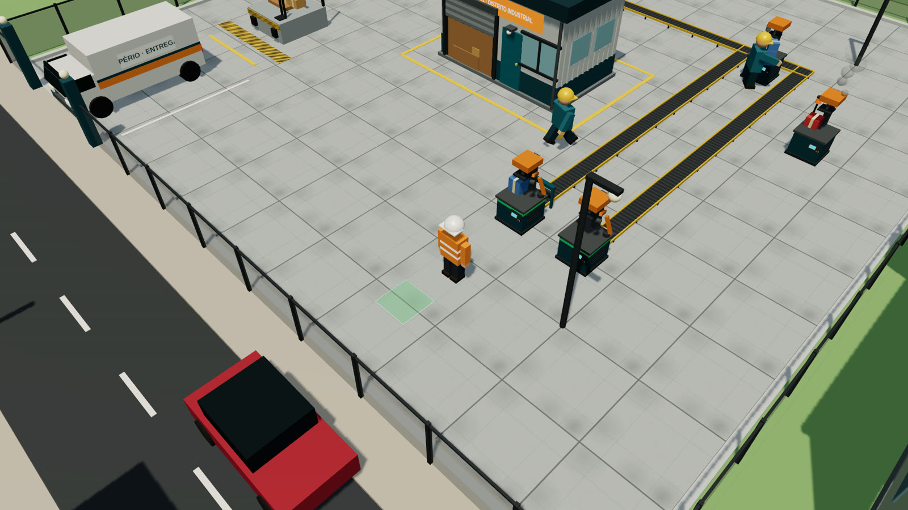
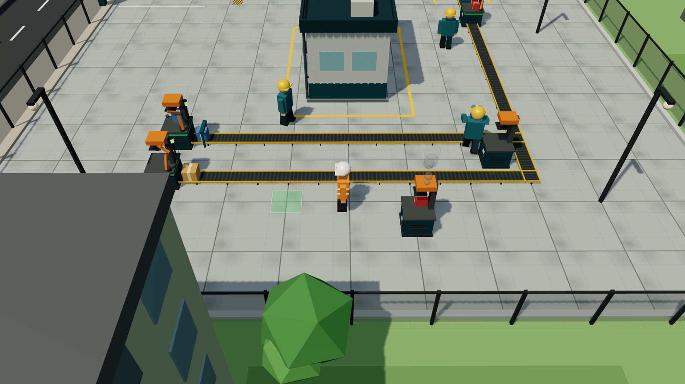
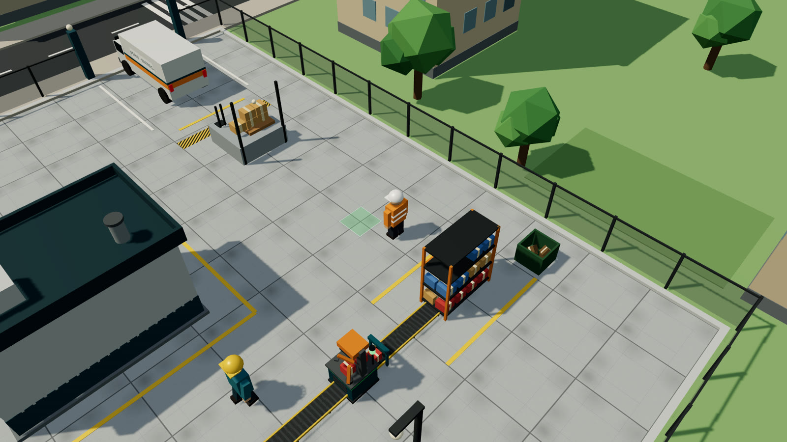
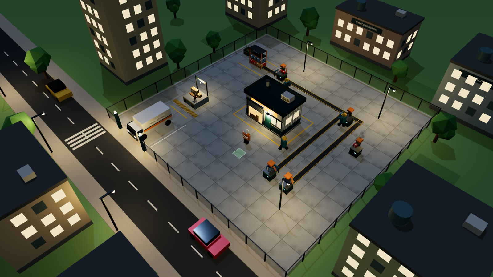

# Guia de como jogar — Do Zero ao Império Industrial 2

Este guia explica tudo o que existe no jogo até a versão **0.6.3**: como começar, o que cada tecla faz, como funcionam contratos, automação, qualidade e energia, e estratégias para crescer rápido.

**Jogue no navegador:** [Portal Pixel](https://hebersonmiliano.github.io/portal-jogos/jogo.html?id=imperio-industrial-2). Funciona no computador com teclado e mouse ou com controle de Xbox, PlayStation e similares.

## Sumário

1. [Objetivo](#1-objetivo)
2. [Começo rápido: os primeiros 10 minutos](#2-começo-rápido-os-primeiros-10-minutos)
3. [Controles](#3-controles)
4. [A tela do jogo](#4-a-tela-do-jogo)
5. [Produzir caixas](#5-produzir-caixas)
6. [Catálogo e preços](#6-catálogo-e-preços)
7. [Estoque e vendas](#7-estoque-e-vendas)
8. [Contratos, clientes e reputação](#8-contratos-clientes-e-reputação)
9. [Funcionários](#9-funcionários)
10. [Esteiras e máquinas automáticas](#10-esteiras-e-máquinas-automáticas)
11. [Luz das máquinas](#11-luz-das-máquinas)
12. [Desgaste, defeitos e manutenção](#12-desgaste-defeitos-e-manutenção)
13. [Inspeção e refugo](#13-inspeção-e-refugo)
14. [Energia](#14-energia)
15. [Dia, noite e câmera](#15-dia-noite-e-câmera)
16. [Som](#16-som)
17. [Salvamento e novo jogo](#17-salvamento-e-novo-jogo)
18. [Tabela de custos](#18-tabela-de-custos)
19. [Estratégias e dicas](#19-estratégias-e-dicas)
20. [Perguntas frequentes](#20-perguntas-frequentes)

---

## 1. Objetivo

Você começa com **R$ 100** numa oficina alugada no Distrito Industrial. A meta da campanha é **vender R$ 1.000**. Contratos e vendas avulsas contam para a meta. A barra laranja no topo da tela mostra o progresso.

Pelo caminho você vai montar máquinas, aceitar contratos de clientes, contratar funcionários, automatizar a linha de produção e manter tudo funcionando com manutenção, inspeção e a conta de luz em dia.

## 2. Começo rápido: os primeiros 10 minutos

1. **Clique em Jogar.** O jogo começa às 7h do Dia 1, com o personagem de colete laranja na frente da oficina.
2. **Aceite um contrato.** No painel da direita aparece a primeira oferta. Aperte **1** para aceitar. Veja qual caixa ela pede, por exemplo "6× Média parda, papelão simples".
3. **Escolha a caixa certa.** Use **T** (tamanho), **C** (cor) e **M** (material) até o painel da esquerda mostrar, em "Próxima caixa", exatamente o produto do contrato.
4. **Coloque uma máquina.** O quadrado verde no chão, à frente do personagem, mostra onde ela vai ficar. Aperte **B** (R$ 60). Se o quadrado estiver vermelho, ande até um lugar livre.
5. **Produza.** Chegue perto da máquina e aperte **E** uma vez por caixa (R$ 2 de papelão cada). As caixas se acumulam em cima da máquina, até 8.
6. **Guarde no estoque.** Ainda perto da máquina, aperte **R**: as caixas vão para o estoque. O painel de contratos mostra quantas você já tem, por exemplo "4/6".
7. **Entregue.** Quando o contrato ficar verde, vá até a **doca de expedição** (plataforma com a placa EXPEDIÇÃO, perto da van) e aperte **V**. O dinheiro sobe da doca e a reputação aumenta.
8. **Repita e cresça.** Com o dinheiro dos primeiros contratos, contrate um funcionário (**F**, R$ 80) ou ligue uma esteira (**L**, R$ 40). Com R$ 100 sobrando, automatize a máquina (**U**).

> Dica: no começo, prefira contratos do **Mercadinho Aurora** e da **Loja Bom Presente**. Eles pedem poucas caixas pequenas ou médias, de papelão simples, que são baratas de produzir.

## 3. Controles

Dá para jogar com **teclado e mouse** ou com **controle** (Xbox, PlayStation e similares). O controle é reconhecido assim que você aperta um botão, e as dicas da tela passam a mostrar os botões dele. Mexeu no teclado ou no mouse, as dicas voltam a mostrar as teclas.

| Ação | Teclado | Controle |
|---|---|---|
| Andar (segue a câmera) | **W A S D** ou setas | Analógico esquerdo |
| Colocar máquina (R$ 60) | **B** | **Y** |
| Produzir caixa (R$ 2) | **E** | **A** |
| Levar saída ao estoque | **R** | **B** |
| Entregar ou vender na expedição | **V** | **X** |
| Tamanho, cor e material | **T**, **C**, **M** | Direcional **↑**, **←**, **→** |
| Aceitar contrato | **1**, **2**, **3** ou clique na oferta | Direcional **↓** (primeira oferta); as outras pelo menu |
| Ligar esteira (R$ 40) | **L** | **RT** |
| Automatizar ou reprogramar (R$ 100) | **U** | **LT** |
| Manutenção ou conserto | **K** | **LB** |
| Inspecionar ou instalar inspetor | **I** | **RB** |
| Contratar funcionário (R$ 80) | **F** | pelo menu |
| Girar a câmera | **Q** e **Z**, ou arrastar o mouse | Analógico direito para os lados |
| Zoom | **+** e **−**, ou roda do mouse | Analógico direito para cima e para baixo |
| Menu de comandos | **Esc** ou botão **Mais** | **Menu** |
| Mostrar controles | **H** | **View** |
| Som | **O** ou botão na barra superior | pelo menu |
| Novo jogo | **N** duas vezes | pelo menu (confirmar duas vezes) |

**Com o mouse**, tudo também pode ser feito por clique: a **barra de ações** no rodapé (Máquina, Produzir, Recolher, Entregar, Esteira, Automatizar, Manutenção, Inspecionar, Funcionário e Mais), os botões **Tamanho**, **Cor** e **Material** no painel da esquerda, as **ofertas de contrato** no painel da direita e o **menu de comandos**.

**No menu de comandos** ficam as ações menos frequentes: contratar funcionário, aceitar as ofertas 1, 2 e 3, ligar ou desligar o som, mostrar os controles e começar um jogo novo. No controle, escolha com o direcional, confirme com **A** e feche com **B**.

O controle vibra quando você vende e quando uma máquina quebra, se o controle e o navegador suportarem vibração.

Para usar uma máquina (produzir, recolher, esteira, automatizar, manutenção, inspetor), fique a menos de 1,8 metro dela, ou seja, encostado.

## 4. A tela do jogo

- **Barra superior:** dinheiro em caixa, vendas e progresso da meta, caixas no estoque, caixas produzidas, máquinas, equipe, relógio (dia e hora) e botão de som.
- **Painel de produção (esquerda):**
  - *Próxima caixa:* o produto que E, os funcionários e a próxima automação vão fabricar.
  - *Linha:* quantas máquinas são automáticas e quantas estão produzindo, quebradas, sem energia, com a saída cheia ou sem papelão.
  - *Energia:* quanto a conta do dia já soma e a tarifa atual.
  - *Qualidade:* caixas com defeito no estoque e total no refugo.
  - *No estoque:* quantas caixas de cada produto.
- **Painel de contratos (direita):** reputação, ofertas e contratos em andamento.
- **Avisos (centro):** mensagens rápidas, como "Caixa produzida" ou "Máquina quebrou!".
- **Rótulos no mundo:** sobre o estoque, a expedição (avisa quando há contrato pronto) e cada máquina (caixas na saída, desgaste ou QUEBRADA). Quando você vende, o valor sobe da doca.

## 5. Produzir caixas

- Toda caixa custa **R$ 2** de papelão, descontados na hora.
- A máquina guarda até **8 caixas** na saída, em cima da mesa. Com a saída cheia, ela não produz mais: aperte **R**, ligue uma esteira ou deixe um funcionário recolher.
- **R** leva as caixas direto para o estoque; não é preciso andar até a prateleira.
- Máquinas ocupam uma célula da grade. Não dá para colocar em cima da oficina, da doca, da van, do estoque, da caçamba, dos postes ou de outra máquina.

## 6. Catálogo e preços

São 3 tamanhos × 3 cores × 2 materiais = **18 caixas diferentes**. A cor muda só a aparência e o que o cliente pede; o preço depende do tamanho e do material.

| Tamanho | Papelão simples | Reforçado |
|---|---|---|
| Pequena | R$ 6 | R$ 12 |
| Média | R$ 10 | R$ 20 |
| Grande | R$ 16 | R$ 32 |

Esses são os preços da **venda avulsa**. Contratos pagam mais (veja a seção 8). O custo de produção é sempre R$ 2, então caixas grandes reforçadas dão o maior lucro por caixa.

## 7. Estoque e vendas

- O estoque fica na **prateleira laranja** no fundo do terreno, separado por produto. A prateleira mostra as caixas nas cores dos produtos.
- Na **expedição**, **V** faz duas coisas:
  1. Entrega todos os contratos que o estoque já cobre, do prazo mais curto ao mais longo.
  2. Se nenhum contrato estiver pronto, vende o **estoque livre**. Caixas de um produto que algum contrato em andamento pediu ficam guardadas.
- Caixa com defeito vendida avulsa vale **metade**.

## 8. Contratos, clientes e reputação

### Como funcionam

- Ofertas aparecem no painel da direita: a primeira logo no começo, depois uma a cada 30 segundos (ou 10 segundos se o quadro estiver vazio). Ficam até **3 ofertas**.
- Cada oferta mostra o cliente, a caixa exata, a quantidade, o pagamento, o prazo e em quanto tempo ela some (1 minuto). Deixar sumir não tem penalidade.
- Você pode ter até **3 contratos** ao mesmo tempo. Aceite com **1**, **2** ou **3**.
- O painel mostra quantas caixas do produto você já tem. Fica **verde** quando está pronto e **vermelho** quando faltam menos de 20 segundos.

### Pagamento, multa e reputação

| Situação | Efeito |
|---|---|
| Entrega no prazo, sem defeitos | Recebe o pagamento inteiro e **+5** de reputação |
| Entrega com caixas defeituosas | O cliente devolve e não paga por elas; **−2** de reputação por caixa (até −10) |
| Prazo vence | Multa de **25%** do pagamento e **−10** de reputação |

O pagamento por caixa é o preço avulso × a margem do cliente × (1 + reputação ÷ 200). Com reputação 100, o contrato paga 50% a mais.

### Reputação

Vai de 0 a 100 e começa em **20**. Faixas: **Bairro** (0), **Distrito** (30), **Regional** (60) e **Referência** (85). Reputação maior libera clientes maiores:

| Cliente | Reputação mínima | Pede | Quantidade | Prazo | Margem |
|---|---|---|---|---|---|
| Mercadinho Aurora | 0 | P ou M, parda, simples | 4 a 8 | 1:30 | ×1,3 |
| Loja Bom Presente | 0 | P ou M, azul ou vermelha, simples | 3 a 6 | 1:40 | ×1,5 |
| Confeitaria Doce Grão | 15 | P, vermelha, simples ou reforçada | 6 a 10 | 1:30 | ×1,6 |
| Transportadora Rota Sul | 30 | G, parda, reforçada | 6 a 12 | 2:30 | ×1,5 |
| Loja Virtual Clique | 50 | M ou G, qualquer cor, reforçada | 10 a 16 | 2:40 | ×1,7 |
| Rede Varejo Centro | 70 | M ou G, parda ou azul | 18 a 30 | 4:00 | ×1,9 |

Os prazos contam em tempo de jogo (minutos:segundos).

## 9. Funcionários

- **F** contrata um funcionário (R$ 80, até 3). Não há salário nesta versão.
- Eles trabalham sozinhos, de capacete amarelo:
  - **Produzem** em máquinas **manuais** que não estejam quebradas nem cheias, fabricando a caixa escolhida em "Próxima caixa". Cada caixa custa R$ 2, como a sua.
  - **Recolhem** a saída de máquinas **sem esteira** e levam ao estoque, carregando as caixas nas mãos.
- Eles não produzem em máquinas automáticas e não recolhem máquinas com esteira, porque a linha já cuida delas.

> Atenção: mudar T, C ou M muda também o que os funcionários fabricam.

## 10. Esteiras e máquinas automáticas

- **Esteira (L, R$ 40):** liga a máquina ao estoque. Pega uma caixa a cada 1,2 segundo e a leva a 1,5 metro por segundo. A rota faz um L e contorna a oficina, a doca, a van e a caçamba.
- **Automação (U, R$ 100):** a máquina passa a produzir sozinha uma caixa a cada **3 segundos**, do produto escolhido no momento. Ganha um braço robótico laranja e uma faixa verde.
- **Reprogramar (U de novo):** troca o produto da máquina automática para a "Próxima caixa" atual, sem custo. Use para atender cada contrato.
- **Linha completa:** máquina automática + esteira = caixas chegando ao estoque sem você fazer nada.
- Uma esteira dá conta de uma máquina automática com folga. Sem esteira, a máquina automática enche a saída em 24 segundos e para, a menos que você (R) ou um funcionário recolha as caixas.

## 11. Luz das máquinas

Cada máquina tem uma torre de luz:

| Luz | Situação |
|---|---|
| Apagada | Máquina manual, sem automação |
| Verde | Automática, produzindo |
| Amarela | Automática, sem dinheiro para papelão (menos de R$ 2 em caixa) |
| Vermelha | Saída cheia: recolha com R ou ligue uma esteira |
| Laranja piscando, com fumaça | Quebrada: conserte com K |
| Azul | Sem energia: a conta de luz está atrasada |

## 12. Desgaste, defeitos e manutenção

- **Desgaste:** cada caixa desgasta a máquina em **2%**. O rótulo sobre a máquina mostra o desgaste a partir de 50%.
- **Defeitos:** a chance de uma caixa sair com defeito é de **3%** com a máquina nova e sobe até **28%** com ela totalmente gasta. A caixa defeituosa sai mais escura e torta.
- **Quebra:** abaixo de 70% de desgaste a máquina não quebra. Entre 70% e 99%, cada caixa tem uma chance que cresce com o desgaste. Em 100% ela quebra com certeza. Quebrada, ela para até ser consertada.
- **K perto da máquina:**
  - *Manutenção preventiva:* custa 30% do desgaste em reais (de R$ 5 a R$ 30) e zera o desgaste.
  - *Conserto:* se ela já quebrou, custa **R$ 60** e também zera o desgaste.

> Faça a manutenção quando o rótulo passar de 50%: custa até R$ 15, reduz defeitos e evita a quebra de R$ 60.

## 13. Inspeção e refugo

- Sem inspeção, as caixas com defeito vão para o estoque misturadas às boas. Na entrega de um contrato, saem na mesma proporção que existe no estoque e voltam como devolução.
- **Inspeção manual (I perto do estoque):** confere todo o estoque e manda as defeituosas para a **caçamba de refugo**. Custa R$ 1 a cada 5 caixas.
- **Inspetor automático (I perto de máquina com esteira, R$ 80):** um pórtico com sensor verde na esteira separa as defeituosas antes de chegarem ao estoque, sem custo extra.
- O painel de produção avisa quantas caixas com defeito há no estoque.

> Antes de entregar um contrato grande, aperte I no estoque. Uma inspeção de 20 caixas custa R$ 4 e pode evitar uma devolução com perda de reputação.

## 14. Energia

- Máquinas e esteiras consomem energia, cobrada por hora de jogo:

| Item | Custo por hora (tarifa normal) |
|---|---|
| Máquina automática produzindo | R$ 1,00 |
| Esteira levando caixas | R$ 0,35 |
| Máquina ligada sem produzir | R$ 0,08 |

- **Tarifa:** noturna das 22h às 6h (×0,6, mais barata), de pico das 18h às 21h (×1,5, mais cara) e normal no resto do dia. O painel mostra a tarifa atual.
- **Conta:** à meia-noite a conta do dia é cobrada do caixa. Uma máquina automática produzindo o dia todo gasta cerca de R$ 24.
- **Corte:** se faltar dinheiro, o que faltar vira dívida e a energia é **cortada**: máquinas automáticas e esteiras param (luz azul). A dívida é paga sozinha assim que entra dinheiro, e a linha volta a funcionar.

> Guarde dinheiro antes da meia-noite. Uma venda avulsa na expedição (V) costuma resolver um corte.

## 15. Dia, noite e câmera

- Um dia dura **6 minutos** de jogo (uma hora de jogo dura 15 segundos). O jogo começa às 7h.
- À noite acendem janelas, letreiros, postes e faróis da van, a energia fica mais barata e a música muda de clima.
- A câmera segue o personagem. Gire com **Q** e **Z** ou arrastando o mouse; aproxime e afaste com **+**, **−** ou a roda do mouse.

## 16. Som

- A trilha "Turno no Distrito" começa só com piano e pad na oficina vazia. Entram baixo e chimbal quando há máquinas, bateria quando uma máquina automática está produzindo, e a melodia completa com duas ou mais.
- À noite o arranjo fica mais suave, com a melodia em timbre de sino.
- Efeitos: prensa, venda, contrato aceito, novo cliente, máquina colocada, compras, quebra, conserto e erro. Máquinas mais longe soam mais baixo.
- **O** ou o botão "Som ligado" na barra liga e desliga. O jogo lembra a escolha.

## 17. Salvamento e novo jogo

- O jogo salva sozinho a cada 5 segundos e ao fechar ou trocar de aba. O canto da barra superior mostra **"Salvo há X s"**.
- Na tela inicial aparece **Continuar** com o dia, a hora e o dinheiro da partida salva.
- O save fica **no navegador**. Outro navegador, outro computador ou uma janela anônima começam do zero. Limpar os dados do site apaga o progresso.
- A cada minuto o jogo guarda uma **cópia de segurança**, usada se o save principal estragar.
- Se a barra mostrar **"Não está salvando"** em vermelho, o navegador está bloqueando o armazenamento (janela anônima ou dados de sites bloqueados). A tela inicial também avisa. Nesse caso, use o código do progresso.

### Código do progresso

Para guardar a partida fora do navegador ou continuar em outro computador:

1. Abra o menu (**Esc**, botão **Mais** ou **Menu** no controle).
2. Escolha **Copiar código do progresso**. Aparece um texto que começa com `II2-` e ele já vai para a área de transferência. Guarde num arquivo ou mande para você mesmo.
3. No outro navegador, abra o menu, escolha **Carregar progresso de um código**, cole o texto e clique em **Carregar**. A partida atual daquele navegador é substituída.

> Dica: copie o código de vez em quando. É o seu backup, mesmo que alguém limpe o navegador.

### Novo jogo

**N** duas vezes (em até 3 segundos), ou **Novo jogo** no menu confirmando duas vezes, apaga o progresso e a cópia de segurança e recomeça.

## 18. Tabela de custos

| Item | Custo |
|---|---|
| Papelão por caixa | R$ 2 |
| Máquina | R$ 60 |
| Funcionário (até 3) | R$ 80 |
| Esteira | R$ 40 |
| Automação de máquina | R$ 100 (reprogramar é grátis) |
| Inspetor automático | R$ 80 por esteira |
| Manutenção preventiva | R$ 5 a R$ 30 |
| Conserto | R$ 60 |
| Inspeção manual | R$ 1 a cada 5 caixas |
| Multa de contrato vencido | 25% do pagamento |

## 19. Estratégias e dicas

**Primeiro dia**
- Não gaste tudo: depois da primeira máquina sobram R$ 40, que pagam 20 caixas.
- Comece pelos contratos pequenos do Mercadinho e da Loja Bom Presente. Cada entrega no prazo dá +5 de reputação; com 30 aparece a Transportadora, que paga bem por caixas grandes reforçadas.
- Ordem de compra que costuma funcionar: máquina → contratos → esteira → automação → segunda máquina → funcionário.

**Linha de produção**
- Toda máquina automática deve ter esteira; senão ela enche em 24 segundos e para, ou prende um funcionário só recolhendo caixas.
- Reprograme a máquina automática (U) para o produto de cada contrato e volte para a caixa mais lucrativa entre contratos.
- Deixe uma máquina **manual** para os funcionários fazerem pedidos pequenos de outro produto, enquanto a automática trabalha no principal.
- Máquinas perto da prateleira têm esteiras curtas, e as caixas chegam mais rápido.

**Dinheiro**
- Caixa grande reforçada vale R$ 32 avulsa e custa R$ 2. É a melhor para vender sem contrato.
- Contratos pagam de 30% a 90% a mais que a venda avulsa, e mais ainda com reputação alta.
- Mantenha sempre algum dinheiro: abaixo de R$ 2 as máquinas automáticas param (luz amarela), e sem dinheiro à meia-noite a energia é cortada.

**Qualidade**
- Faça manutenção preventiva por volta de 50% de desgaste.
- Instale o inspetor nas esteiras das máquinas que mais produzem.
- Antes de entregar um contrato grande, inspecione o estoque.

## 20. Perguntas frequentes

**Aperto B e nada acontece.** O quadrado no chão está vermelho (célula ocupada) ou você não tem R$ 60. Ande para um lugar livre; o aviso no centro da tela explica o motivo.

**Aperto E e não produz.** Chegue mais perto da máquina, confira se a saída não está cheia (8 caixas), se ela não está quebrada e se você tem pelo menos R$ 2.

**V não vende nada.** Você precisa estar na doca de expedição. Se o estoque só tiver caixas reservadas para contratos que ainda não fecharam a quantidade, elas não são vendidas.

**O contrato não fica pronto.** Confira se o produto é exatamente o pedido: tamanho, cor e material. "Média azul reforçada" é diferente de "Média azul, papelão simples".

**Minhas máquinas automáticas pararam.** Veja a cor da luz (seção 11): amarela é falta de dinheiro, vermelha é saída cheia, laranja é quebra e azul é corte de energia.

**Perdi reputação sem atrasar.** Caixas com defeito foram devolvidas. Inspecione o estoque ou instale inspetores.

**Não ouço a música.** O som começa depois do primeiro clique ou tecla. Confira se o botão na barra está em "Som ligado" (tecla O).

**Dá para jogar no celular?** Ainda não: o jogo precisa de teclado, mouse ou controle.

**Perdi meu progresso.** O save fica no navegador em que você jogou. Confira se está no mesmo navegador, sem janela anônima, e se os dados do site não foram limpos. A versão de testes que abre dentro do Claude é separada do Portal Pixel e pode não guardar o save; jogue pelo portal. Para nunca mais perder, copie o código do progresso no menu de vez em quando.

**Meu controle não funciona.** Aperte qualquer botão com a página do jogo em foco; o navegador só mostra o controle ao site depois disso. Controles de Xbox e PlayStation funcionam por USB ou Bluetooth em navegadores como Chrome, Edge e Firefox.

---

*Guia da versão 0.6.3. Os números deste guia vêm direto das regras do jogo (`js/`). Se uma versão nova mudar algo, o guia é atualizado junto.*
